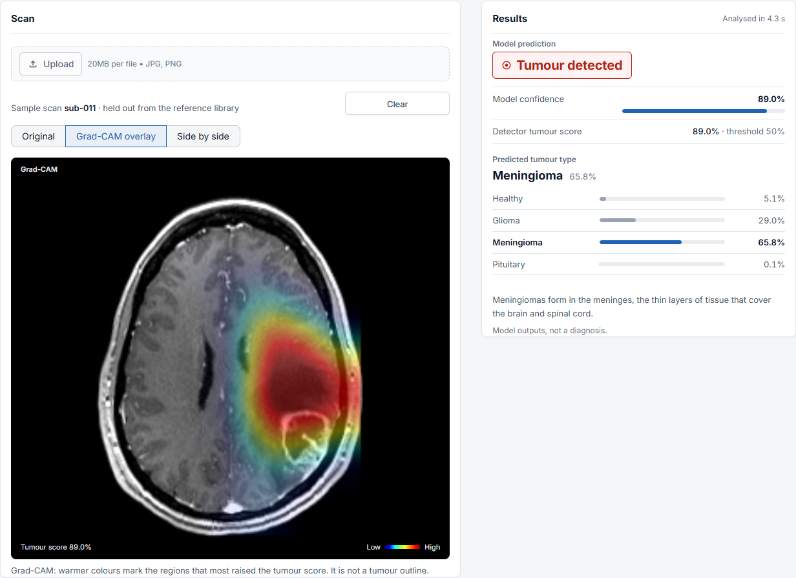
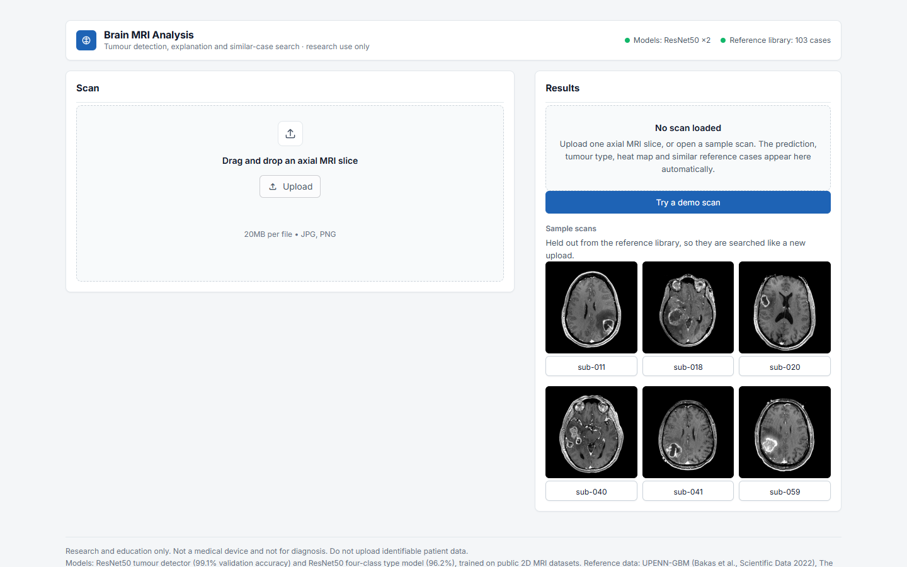
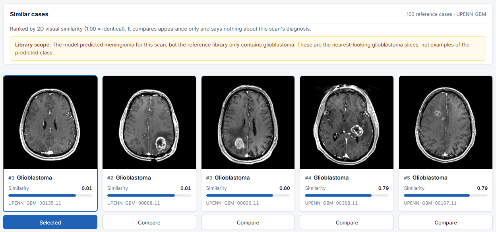
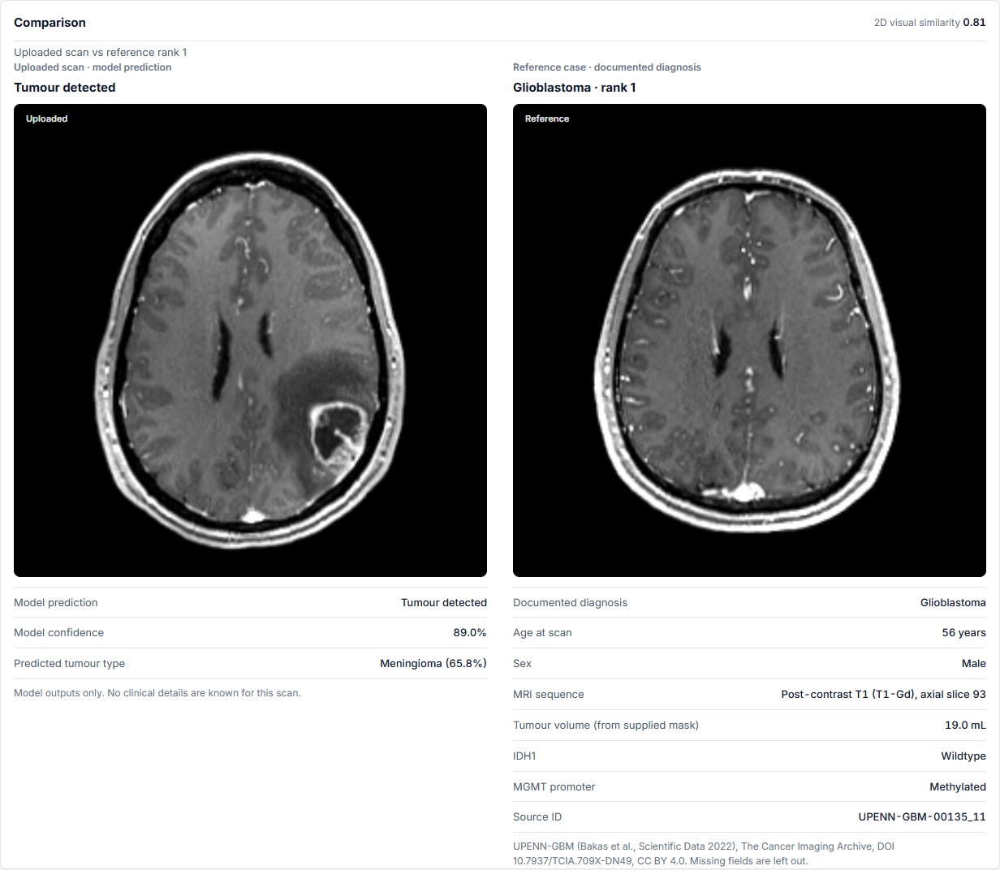
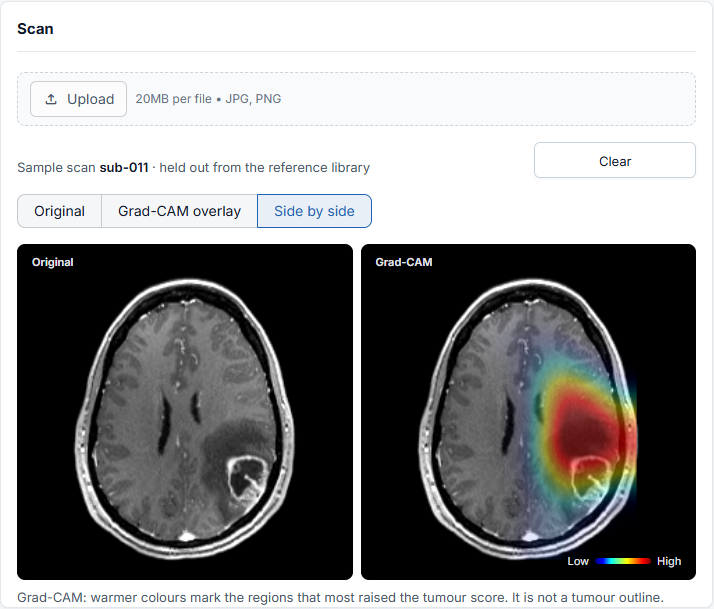
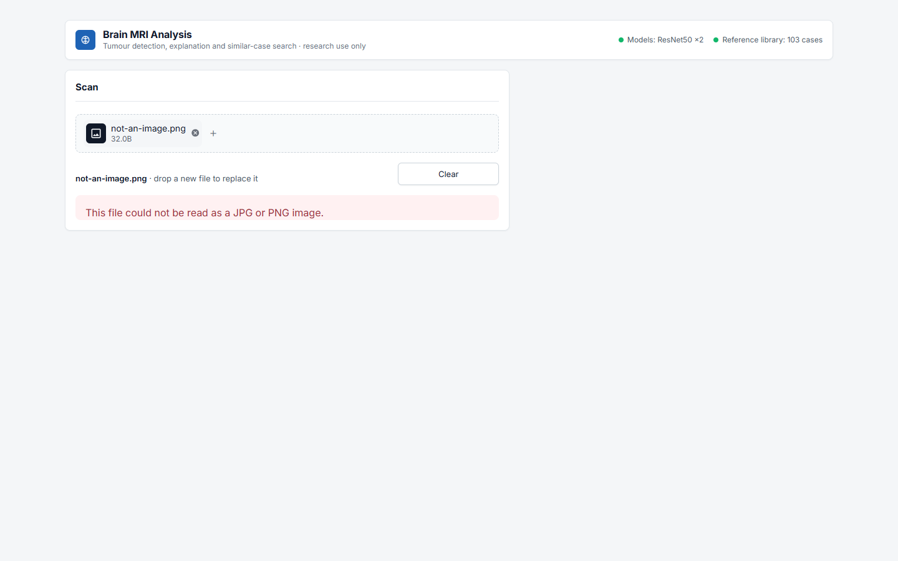
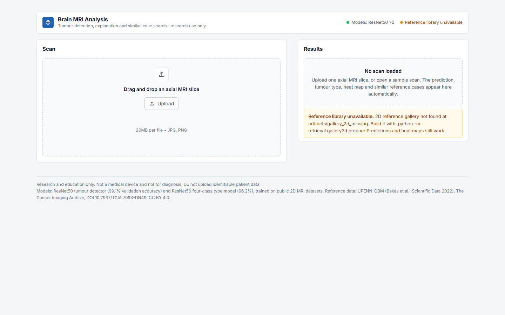
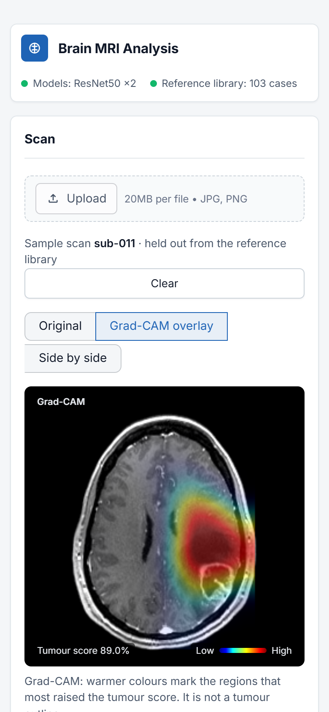

# Explainable Tumor-Aware Similar-Case Retrieval for Brain MRI Analysis

**Minor Project II (AID0301)** · B.Tech Computer Science & Engineering · ITM University

A research prototype that takes **one brain MRI slice** and, on a single page, shows a tumour prediction with
model confidence, the likely tumour type, a Grad-CAM heat map of the regions behind the prediction, and the most
visually similar **documented reference cases** from a public glioblastoma collection, side by side with their
recorded clinical details.

> **For education and research only.** This is not a medical device, it has not been clinically validated, and
> it must not be used to make or support a diagnosis. Do not upload identifiable patient data.



## Contents

1. [Project title](#explainable-tumor-aware-similar-case-retrieval-for-brain-mri-analysis)
2. [Overview](#overview)
3. [Problem statement](#problem-statement)
4. [Objectives](#objectives)
5. [Technologies](#technologies)
6. [Key features](#key-features)
7. [System requirements](#system-requirements)
8. [Installation](#installation)
9. [Run steps](#run-steps)
10. [Database configuration (file-backed reference gallery)](#database-configuration-file-backed-reference-gallery)
11. [Working screenshots](#working-screenshots)
12. [Team details](#team-details)

Also: [How it works](#how-it-works) · [Results and what each number means](#results-and-what-each-number-means) ·
[Limitations and future work](#limitations-and-future-work) · [Testing](#testing) · [Repository structure](#repository-structure) ·
[Troubleshooting](#troubleshooting) · [Data sources, licences and citation](#data-sources-licences-and-citation)

---

## Overview

Most introductory brain-MRI projects stop at a label: *tumour* or *no tumour*. In practice, a reader of a new scan
also wants **context**: what did the model look at, and which previously documented cases look like this one?

This project combines three things in one workflow:

| Step | What happens | Output |
|---|---|---|
| **Detect** | A fine-tuned ResNet50 scores the slice for tumour | *Tumour detected* / *No tumour detected* with model confidence |
| **Classify** | If a tumour is detected, a second ResNet50 model scores four classes | Predicted type (glioma, meningioma, pituitary) with all four class probabilities |
| **Explain** | Grad-CAM on the detector | Heat map over the original scan (original / overlay / side-by-side views) |
| **Retrieve** | The slice's ResNet50 image embedding is compared with 103 clean UPENN-GBM reference slices | Five ranked reference cases with a 2D visual-similarity score, documented diagnosis, age, sex, tumour volume, IDH1 and MGMT where recorded |

Everything runs from **one upload**. The two classifiers and the retrieval share the same uploaded image; the
reference library is a set of local files (no database server).

## Problem statement

Given a single axial brain MRI slice, the system should (a) estimate whether a tumour is present and, if so, its
likely type; (b) show which image regions drove that estimate; and (c) retrieve previously documented cases that
*look* similar, so the prediction can be read alongside real reference cases rather than as a bare label.

The approved research question (from the project synopsis) is broader: *how should a brain tumour be represented so
that similar cases can be retrieved meaningfully?* This repository implements and evaluates the first, image-level
baseline of that question; tumour-region (lesion-focused) representations are listed under
[future work](#limitations-and-future-work).

## Objectives

1. Detect tumours in a 2D brain MRI slice and report the model's confidence separately from any other score.
2. Suggest the tumour type with a second-stage classifier, showing all class probabilities.
3. Explain each prediction with a Grad-CAM heat map that can be compared with the original scan.
4. Retrieve the five most similar documented reference cases from a public, citable dataset, with a side-by-side
   comparison and the reference case's recorded details.
5. Keep the workflow reproducible: patient-level held-out demo cases, verified image-to-metadata joins, documented
   commands and automated tests.

## Technologies

| Area | Tools |
|---|---|
| Language | Python 3.12 (64-bit) |
| Web application | Streamlit 1.x (single page), custom CSS (`assets/app.css`) |
| Deep learning | TensorFlow / Keras 2.20 (ResNet50 detector and four-class type model, Grad-CAM) |
| Image processing | OpenCV, Pillow, imutils, NumPy |
| Medical imaging | nibabel (NIfTI), SciPy |
| Retrieval | ResNet50 global-average-pooled embeddings, cosine similarity (NumPy), pandas metadata |
| Models hosting | Hugging Face Hub (`mvdu/brain-tumor-models`, downloaded at run time) |
| Reference data | UPENN-GBM (The Cancer Imaging Archive) via the `data-nih/tcia` GitHub mirror |
| Data preparation | Local Python builder or the included Google Colab notebook |
| Testing | pytest + `unittest`, Streamlit `AppTest` |

## Key features

- **One upload, one page:** drag and drop a JPG/PNG slice (or open a held-out sample scan) and every result appears
  automatically, in reading order: prediction → tumour type → Grad-CAM → similar cases → comparison.
- **Clear prediction:** a labelled status badge (*Tumour detected* / *No tumour detected*), the model's confidence, and
  the detector's tumour score against its 50% threshold.
- **Tumour type with full breakdown:** the four-class probabilities (healthy, glioma, meningioma, pituitary). If the two
  models disagree (detector says tumour, type model says healthy), no type is reported and the page says why.
- **Explainability:** Grad-CAM with *Original*, *Grad-CAM overlay* and *Side by side* views and an on-image colour scale.
- **Similar-case retrieval:** the five closest of 103 documented UPENN-GBM reference slices, each with its
  **2D visual similarity**, documented diagnosis and source ID; choose any of them for a side-by-side comparison
  without re-running the models.
- **Honest scope messages:** the reference library contains glioblastoma only; when the prediction is another class
  or *no tumour*, the page says so next to the results.
- **Safe failure:** an unreadable file, a failed heat map or a missing reference library each produce a plain-language
  message while the rest of the results stay visible.
- **Responsive layout** for phones and desktops; an optional access password (Streamlit secret).

## System requirements

| | Minimum | Tested |
|---|---|---|
| OS | Windows 10/11, Linux or macOS (64-bit) | Windows 11 |
| Python | **3.12, 64-bit** (the pinned `tensorflow==2.20.0` did not install on Python 3.14) | 3.12.9 |
| Memory | 4 GB free RAM; the app itself commits about 0.7 GB with both models loaded | 7.3 GB machine |
| Disk | ~3 GB for the virtual environment, ~0.3 GB for cached model weights, ~10 MB for the reference gallery, ~1.6 GB temporarily while building the bundle | |
| Network | Needed on first run (model weights from Hugging Face) and once to build the reference gallery | |
| GPU | Not required | CPU only |

> Windows users with several Python versions: `python` may point to a newer interpreter (for example 3.14) where
> `tensorflow==2.20.0` will not install. Always create the environment with `py -3.12`.

## Installation

Windows PowerShell, from the folder where you want the project:

```powershell
git clone https://github.com/devrajsengar786-sssup/brain-tumor-detection.git
cd brain-tumor-detection
py -3.12 -m venv .venv
.\.venv\Scripts\python.exe -m pip install --upgrade pip
.\.venv\Scripts\python.exe -m pip install -r requirements.txt
```

To run the tests as well: `.\.venv\Scripts\python.exe -m pip install pytest`.

`requirements.txt` pins TensorFlow, NumPy and nibabel; other packages resolve to their latest compatible versions. If a
future release breaks the install, use the exact set that was tested on 2026-11-18 instead:
`.\.venv\Scripts\python.exe -m pip install -r requirements-lock.txt`.

Linux/macOS: replace `py -3.12` with `python3.12` and `.\.venv\Scripts\python.exe` with `.venv/bin/python`.

## Run steps

The repository ships a ready-built reference gallery (`data/gallery_2d/`, 3.3 MB), so the app works straight after
installation:

```powershell
.\.venv\Scripts\python.exe -m streamlit run app.py
```

Streamlit opens `http://localhost:8501`. Upload a JPG/PNG axial MRI slice, or press **Try a demo scan**.
The first analysis downloads the two model files from Hugging Face (about 2 × 130 MB, cached afterwards; no account
needed).

**Optional: rebuild the gallery yourself from the public data** (to reproduce it, or after changing the builder):

```powershell
# 1. Build the input bundle from the public UPENN-GBM mirror (~1.6 GB download, see section 10)
.\.venv\Scripts\python.exe -m retrieval.cli build-upenn-bundle --raw-dir ..\upenn_raw --out artifacts\gallery_bundle

# 2. Build the searchable 2D gallery from the bundle (written to artifacts\gallery_2d, which the app then prefers)
.\.venv\Scripts\python.exe -m retrieval.gallery2d prepare
```

Measured on a clean clone (Windows 11 laptop, 2026-11-18): step 1 took **57 minutes** (mostly the 1.5 GB download),
step 2 took **3.5 minutes**, and the result was identical to the shipped gallery. After step 1 the raw folder
(`..\upenn_raw`) is no longer needed and can be deleted.

**Streamlit Community Cloud:** deploy `app.py` from this repository with Python 3.12. No secrets or extra steps are
needed; the app uses the shipped gallery automatically.

## Database configuration (file-backed reference gallery)

There is **no database server** to install or configure. The reference library is a folder of files that the app
loads read-only at start-up.

### What the app reads

The app picks the reference gallery folder in this order:

1. `GALLERY_2D_DIR`, if set as an environment variable or as a key in `.streamlit/secrets.toml`;
2. `artifacts/gallery_2d/`, if you built one locally with `prepare` (git-ignored);
3. `data/gallery_2d/`, the prebuilt gallery shipped in the repository (this is what Streamlit Cloud uses).

Both built-in locations have the same layout:

```text
data/gallery_2d/   (or artifacts/gallery_2d/)
├── cases.csv          # one row per slice: case_id, role (reference | demo), participant_id, verified,
│                      # diagnosis, sequence, slice_index, age_years, sex, tumour_volume_ml, idh1, mgmt, pixel_sha256
├── index.npz          # 103 L2-normalised 2048-d ResNet50 embeddings of the reference slices (+ case IDs, feature name)
├── manifest.json      # source, counts, verification summary, index details
├── reference/*.png    # 103 clean post-contrast T1 slices (searchable)
└── demo/*.png         # 22 held-out slices (never indexed; used by "Try a demo scan")
```

If the folder is missing or incomplete, the app still runs and shows *Reference library unavailable* with the exact
command to fix it. Changing `GALLERY_2D_DIR` points the app at another gallery without code changes.

### Where the gallery comes from

The shipped `data/gallery_2d/` was produced exactly this way from public data. To rebuild it, the gallery is built
from an *input bundle* by `python -m retrieval.gallery2d prepare`:

| | Location | Contents |
|---|---|---|
| **Input bundle** (read) | `artifacts/gallery_bundle/` | `gallery_metadata.csv` (103 reference cases), `demo_metadata.csv` (22 held-out cases), `evaluation/secondary_labels.csv` (IDH1, MGMT) |
| **Source scans** (read, streamed) | `https://github.com/data-nih/tcia/releases/download/upenn-gbm/` | `sub-NNN_ce-gd_T1w.nii.gz` and `sub-NNN_seg.nii.gz` for each of the 125 cases (about 0.4 GB); held in memory only, never written to disk |
| **Output gallery** (written) | `artifacts/gallery_2d/` | the files listed above |

`prepare` exports, for every case, the axial post-contrast T1 slice with the largest tumour area, and **verifies the
image-to-metadata join**: the participant ID must be the numeric counterpart of the mirror subject
(`sub-002` → `UPENN-GBM-00002_11`), the recorded slice must be the largest tumour slice of the supplied mask, and the
mask volume must equal the bundle's tumour volume. Unverified cases are not searchable. The step is resumable
(`prepare` = `slices` + `index`; each can also be run separately).

### Getting the input bundle (no private storage needed)

Both routes use only the public UPENN-GBM mirror (CC BY 4.0) and produce the same bundle.

**Route A — local builder (recommended for evaluators).** One command; downloads the 147 complete baseline cases
(about 1.6 GB, resumable) into a raw folder you choose, validates every case, splits patients 70/15/15 with seed 42
and writes the bundle:

```powershell
.\.venv\Scripts\python.exe -m retrieval.cli build-upenn-bundle --raw-dir ..\upenn_raw --out artifacts\gallery_bundle
```

Keep the raw folder outside the repository (it is ignored by Git anyway) and delete it afterwards. Tested from a fresh
clone on 2026-11-18: all 147 cases downloaded and passed validation, and the three files `prepare` reads were
**identical** to the project's Colab-built bundle, so both routes give the same gallery.

**Route B — Google Colab.** Open `notebooks/upenn_gbm_gallery_colab.ipynb` in Colab and run all cells. It does the same
steps on the Colab VM (raw scans never reach your computer) and saves `gallery_bundle.zip` to your Google Drive.
Unzip it into `artifacts/gallery_bundle/`, then run `prepare`.

## Working screenshots

All screenshots were taken with **public held-out demo scans** from the UPENN-GBM collection (no patient uploads).
Build details are in [`docs/screenshots/BUILD.md`](docs/screenshots/BUILD.md).

| | |
|---|---|
|  **Start screen** — upload panel, sample scans |  **Analysis** — prediction, confidence, tumour type, Grad-CAM |
|  **Similar cases** — five ranked UPENN-GBM references |  **Comparison** — uploaded scan vs documented reference |
|  **Grad-CAM side by side** |  **Invalid upload** — readable error |
|  **No reference library** — app still usable |  **Phone layout** |

The full results page is in [`docs/screenshots/02-full-result-page.png`](docs/screenshots/02-full-result-page.png).

## Team details

| | |
|---|---|
| Project | Explainable Tumor-Aware Similar-Case Retrieval for Brain MRI Analysis |
| Subject | Minor Project II (AID0301) |
| Programme | B.Tech, Computer Science & Engineering, ITM University |
| Team | **Vishal Goyal** (BETN1AI25107) · **Devraj Singh Sengar** (BETN1AI25230) |
| Supervisor | Mr. Shubham Dhakrey, Assistant Professor, Department of Computer Science & Engineering |

---

## How it works

```text
          one JPG/PNG upload
                 │
        brain-region crop (same preprocessing as training)
        ┌────────┴──────────────────────────┐
  224×224 → ResNet50 detector         128×128 → ResNet50 four-class model
  tumour score (sigmoid)               type probabilities ──────────────┐
  Grad-CAM on last conv layer          global-average-pooled 2048-d    │
        │                              embedding                       │
        ▼                                     ▼                        ▼
  prediction + confidence + heat map   cosine similarity vs 103   predicted type
                                       reference embeddings       (only if a tumour
                                       → top 5 + metadata          is detected)
```

- **Inference** (`inference.py`): the detector decides *Tumour detected* when its score is above 0.5. *Model
  confidence* is the score of the predicted label (score, or 1 − score). The type model runs on every image so its
  embedding can be used for retrieval, but its type is only reported when a tumour is detected and its top class
  is not *Healthy*.
- **Retrieval** (`retrieval/gallery2d.py`): the query and every reference slice go through the same brain crop and the
  same ResNet50 backbone; vectors are L2-normalised and ranked by **cosine similarity**. A reference image that is
  pixel-identical to the upload (same decoded pixels) or has similarity ≥ 0.9995 is excluded from its own results.
- **App** (`app.py`): Streamlit page. The analysis is stored per upload, so switching scan views or choosing another
  reference case never re-runs the models; uploading a different file replaces all earlier results.
- **Memory** (`runtime_limits.py`): limits BLAS/TensorFlow threads before they load, which cut the app's committed
  memory from about 1.7 GB to about 0.7 GB on a 12-core laptop with identical predictions.

## Results and what each number means

The page shows three different kinds of number. They are **not interchangeable**:

| Number | What it is | What it is *not* |
|---|---|---|
| **Model confidence** (e.g. 89.0%) | The classifier's own score for the label it predicted | A probability of disease or a measured accuracy |
| **2D visual similarity** (0–1) | Cosine similarity of two ResNet50 image embeddings | Evidence that the uploaded scan has the reference case's diagnosis |
| **Validation accuracy** (below) | Measured once, on the training datasets' held-out split | A measurement on UPENN-GBM or on your images |

Validation accuracy recorded in `brain_tumor_detection.ipynb` (final training run) for the two models the app uses:

| Model | Task | Validation accuracy | Dataset |
|---|---|---|---|
| ResNet50 (fine-tuned) | Tumour / no tumour | 99.07% | `akar49/MRI_Classification` (Hugging Face) |
| ResNet50 (fine-tuned) | Healthy / glioma / meningioma / pituitary | 96.18% | Brain Tumor MRI Dataset (Kaggle, M. Nickparvar) |

The notebook also trains VGG16 and a custom CNN for both tasks (lower accuracy; see the notebook and `assets/`
training charts). The app uses the two ResNet50 models only.

**Observed domain shift (measured, not a benchmark).** Run on the 125 clean UPENN-GBM post-contrast T1 slices (all
documented glioblastoma, each the slice with the largest tumour area), the detector flagged **74 of 125 (59%)** as
*Tumour detected*, and among those the type model said glioma for only 27. The classifiers were trained on differently
acquired and pre-processed 2D images; scans from another source can be scored very differently. This is why the page
keeps confidence, similarity and recorded accuracy separate and why the retrieval results carry a scope note.

**Retrieval quality is not yet measured.** There are no independent, predefined relevance judgments for the 2D
gallery, so Precision@K, Recall@K and mAP@K are not reported. The code for those metrics exists in
`retrieval/evaluation.py`.

## Limitations and future work

- **Glioblastoma-only reference library.** All 103 reference cases are de novo glioblastoma (UPENN-GBM). For a scan
  predicted as meningioma, pituitary tumour or no tumour, the retrieved cases are only the nearest-looking glioblastoma
  slices; the page says so.
- **Whole-slice similarity.** Retrieval compares whole-brain-crop embeddings. It is not tumour-aware: two slices can be
  similar because of anatomy, slice level or contrast rather than the lesion.
- **Domain shift** between the training datasets and UPENN-GBM (see above). External validation was not performed.
- **Single 2D slice input** and no tumour segmentation of the uploaded scan.

Future work (not implemented or evaluated in this repository's app):

- **Lesion-focused retrieval** using a segmentation mask (e.g. nnU-Net) so similarity is computed on the tumour region.
- **Multi-tumour reference library** covering meningioma, pituitary tumours and tumour-free scans.
- Independent relevance judgments and a validated similarity cut-off; Precision@K / mAP@K reporting.
- Calibrating or fine-tuning the classifiers on UPENN-GBM-like data.

The repository also contains an earlier **3D research baseline** (`retrieval/` volume features, `docs/upenn_gbm_retrieval.md`,
`notebooks/upenn_gbm_gallery_colab.ipynb`) that ranks four-sequence NIfTI examinations with supplied tumour masks. It
produces the input bundle used above, but its separate Streamlit research tab (`retrieval/ui.py`) is **not part of the
current app**. The older multi-model app (model picker, *Model Comparison* tab, separate case-search upload) has been
replaced by the single-upload page.

## Testing

```powershell
.\.venv\Scripts\python.exe -m pip install pytest
.\.venv\Scripts\python.exe -m pytest tests -q
```

| Test file | What it checks | Real or stand-in |
|---|---|---|
| `tests/test_app.py` (11) | The page: empty state, demo scan, order of sections, case selection without re-inference, replacing an upload, invalid file, missing gallery, failed search, failed heat map, scope messages | Streamlit `AppTest` with **tiny stand-in Keras models** and a **synthetic** gallery |
| `tests/test_inference.py` (12) | Brain crop, preprocessing, Grad-CAM overlay, weight loader, prediction/type logic | **Stand-in models** (no downloads) |
| `tests/test_gallery2d.py` (12) | Slice export, join verification, held-out exclusion, exact-copy exclusion, missing fields | **Synthetic** NIfTI files |
| `tests/test_bundled_gallery.py` (3) | The shipped gallery is complete and verified, held-out cases are not searchable, and the app finds it with no configuration (as on Streamlit Cloud) | **Real** shipped gallery; no models loaded |
| `test_retrieval_core.py` (2), `test_index_fixes.py` (13), `test_upenn.py` (10), `test_gallery_bundle.py` (16) | 3D research baseline: splits, scaling, downloads (local HTTP server), validation, bundle | **Synthetic** data |

Result with Python 3.12.9 and the clean-install packages: **79 passed** (2026-11-19). The real models are not
exercised by the automated tests; together with the shipped gallery they were checked end to end in a browser with a
real held-out scan (see `docs/screenshots/BUILD.md`).

## Repository structure

| Path | Purpose |
|---|---|
| `app.py` | Streamlit app (single upload page) |
| `inference.py` | Model loading, preprocessing, Grad-CAM, detection + type + embedding |
| `runtime_limits.py` | Thread limits that keep memory low (imported first by `app.py`) |
| `retrieval/gallery2d.py` | Builds and searches the 2D reference gallery |
| `data/gallery_2d/` | Prebuilt reference gallery (103 searchable + 22 held-out UPENN-GBM slices, index, metadata) |
| `retrieval/cli.py`, `retrieval/experiment.py`, `retrieval/upenn.py` | Builds the input bundle from the UPENN-GBM mirror |
| `retrieval/` (other modules) | 3D research baseline (features, index, bundle, evaluation, nnU-Net helpers) |
| `requirements.txt` | Dependencies for the app and the gallery builder |
| `requirements-lock.txt` | Exact package versions of the tested clean install (fallback) |
| `assets/app.css`, `.streamlit/config.toml` | Visual design (colours, layout) and Streamlit theme |
| `assets/*.png` | Training curves and confusion matrices from the training notebook |
| `brain_tumor_detection.ipynb` | Trains the six classifiers (Kaggle/Colab); the app uses the two ResNet50 models |
| `notebooks/upenn_gbm_gallery_colab.ipynb` | Colab route to build the input bundle |
| `docs/` | Design notes and screenshots |
| `tests/` | Automated tests |

### Retraining the classifiers (optional)

`brain_tumor_detection.ipynb` trains VGG16, a custom CNN and ResNet50 for both tasks and uploads the `.h5` files to
Hugging Face. Run it on Kaggle (GPU T4) with the *Brain Tumor MRI Dataset* (Masoud Nickparvar) attached; the binary
dataset downloads automatically. To use your own uploads, change `HF_REPO_ID` in `inference.py`.

## Troubleshooting

| Problem | Fix |
|---|---|
| `tensorflow==2.20.0` fails to install | Use 64-bit Python 3.12: `py -3.12 -m venv .venv` |
| `OpenBLAS error: Memory allocation still failed` | Close other heavy programs and run only one copy of the app. `runtime_limits.py` already keeps the app near 0.7 GB |
| *Reference library unavailable* | The shipped `data/gallery_2d/` is missing or `GALLERY_2D_DIR` points to a wrong folder. Restore the folder from Git (`git checkout -- data/gallery_2d`), unset `GALLERY_2D_DIR`, or rebuild with `python -m retrieval.gallery2d prepare` (section 10) |
| *The search index was built with ...* | Rebuild the index: `python -m retrieval.gallery2d index` |
| First analysis is slow | The model weights (~260 MB) are downloading from Hugging Face; later runs use the cache |
| Port 8501 already in use | Another copy is running; stop it, or add `--server.port 8502` |
| Optional password | Copy `.streamlit/secrets.toml.example` to `.streamlit/secrets.toml` and set `APP_ACCESS_PASSWORD` (never commit the real file) |

## Data sources, licences and citation

- **UPENN-GBM** (reference library): Bakas S. *et al.*, "The University of Pennsylvania glioblastoma (UPenn-GBM) cohort:
  advanced MRI, clinical, genomics, & radiomics", *Scientific Data* 9, 453 (2022). Data: The Cancer Imaging Archive,
  DOI [10.7937/TCIA.709X-DN49](https://doi.org/10.7937/TCIA.709X-DN49), licence **CC BY 4.0**. Files are read from the
  individual-file mirror `https://github.com/data-nih/tcia/releases/tag/upenn-gbm`. No raw scans (NIfTI volumes) are
  stored in this repository. `data/gallery_2d/` redistributes, under the same CC BY 4.0 licence and with this
  attribution, 125 derived 2D slice images (one axial post-contrast T1 slice per case) and the de-identified fields
  shown in the app (age, sex, tumour volume, IDH1, MGMT) from the collection's public `participants.tsv`.
- **Training data**: `akar49/MRI_Classification` (Hugging Face) and *Brain Tumor MRI Dataset* by Masoud Nickparvar
  (Kaggle).
- **Model weights**: `mvdu/brain-tumor-models` on Hugging Face (public), downloaded at run time and not redistributed here.
- **Code**: MIT licence (see `LICENSE`).
